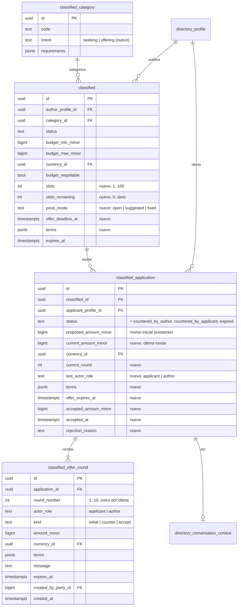
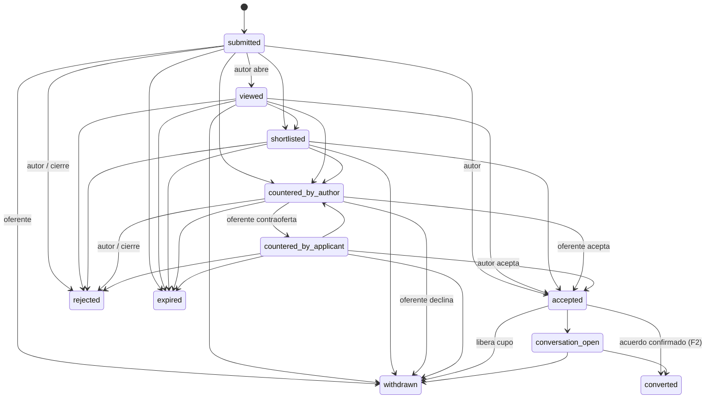

# Marketplace de demanda y oferta — Diseño de datos y contrato

Fecha: 2026-11-08. Implementa la Fase 1 y deja definida la Fase 2. Todo es aditivo sobre
`2026-08-14_music_directory_core.sql` y posteriores.

## 1. Modelo (Fase 1)



### 1.1 `classified_category.intent`

`TEXT NOT NULL DEFAULT 'seeking' CHECK (intent IN ('seeking','offering'))`. Semilla por código:
`offering` para `offering-services`, `equipment-sale-rental`, `room-studio-available`, `classes`,
`artist-profile`; el resto `seeking`. Expuesto en `TaxonomyItem.metadata.intent` y en
`PublicClassified.intent`, `DirectorySearchItem.intent`.

### 1.2 `classified` (columnas nuevas)

| Columna | Tipo | Regla |
| --- | --- | --- |
| `slots` | `INTEGER NOT NULL DEFAULT 1` | `BETWEEN 1 AND 100` |
| `slots_remaining` | `INTEGER NOT NULL DEFAULT 1` | `BETWEEN 0 AND slots`; backfill = `slots` menos ofertas `accepted` existentes (mín. 0) |
| `price_mode` | `TEXT NOT NULL DEFAULT 'open'` | `IN ('open','suggested','fixed')`; `suggested`/`fixed` exigen `budget_max_minor` y `currency_id`; `fixed` exige `budget_min_minor = budget_max_minor` o `budget_min_minor IS NULL` |
| `offer_deadline_at` | `TIMESTAMPTZ` | `NULL` o `<= expires_at` |
| `terms` | `JSONB NOT NULL DEFAULT '{}'` | objeto; claves conocidas: `durationMinutes`, `capacity`, `equipmentProvided`, `equipmentRequired`, `placeLabel`, `timezone`, `paymentNotes`, `recurrence` |

Backfill de `price_mode` para filas existentes: `budget_max_minor IS NULL → 'open'`;
`budget_negotiable → 'suggested'`; `NOT budget_negotiable AND budget_min_minor = budget_max_minor →
'fixed'`; resto `'suggested'`.

Los anuncios derivados (`source_profile_id IS NOT NULL`) conservan `slots=1`, `price_mode='open'`
y no admiten ofertas (el guard de derivación ya impide editarlos).

### 1.3 `classified_application` (columnas nuevas y estados)

Estados: `submitted, viewed, shortlisted, countered_by_author, countered_by_applicant, accepted,
rejected, withdrawn, expired, conversation_open, converted`. La restricción `CHECK` de `status` se
reemplaza; el rollback mapea `countered_by_author → viewed`, `countered_by_applicant → submitted`,
`expired → withdrawn` antes de restaurar la original.

Backfill: `current_amount_minor = proposed_amount_minor`, `current_round = 1`,
`last_actor_role = 'applicant'`, una fila `classified_offer_round` (`round_number=1`,
`kind='initial'`) por oferta existente con `created_at = submitted_at`.

Invariantes (verificados en `Policy` y por `CHECK`):
- `current_round BETWEEN 1 AND 10`.
- `accepted_amount_minor IS NULL` salvo `status IN ('accepted','conversation_open','converted')`.
- `rejection_reason IS NULL` salvo `status='rejected'`; valores: `author_decision`, `slots_filled`,
  `classified_closed`.
- Una oferta activa (`status NOT IN ('rejected','withdrawn','expired')`) por
  (`classified_id`, `applicant_profile_id`): verificado en el handler (`409`); la migración
  incluye consulta de diagnóstico de duplicados históricos y no crea índice único para no fallar
  sobre datos previos.

### 1.4 `classified_offer_round`

```sql
CREATE TABLE classified_offer_round (
  id UUID PRIMARY KEY DEFAULT gen_random_uuid(),
  application_id UUID NOT NULL REFERENCES classified_application(id) ON DELETE CASCADE,
  round_number INTEGER NOT NULL,
  actor_role TEXT NOT NULL,
  kind TEXT NOT NULL,
  amount_minor BIGINT,
  currency_id UUID REFERENCES currency_reference(id),
  terms JSONB NOT NULL DEFAULT '{}'::jsonb,
  message TEXT,
  expires_at TIMESTAMPTZ,
  created_by_party_id BIGINT REFERENCES party(id),
  created_at TIMESTAMPTZ NOT NULL DEFAULT now(),
  UNIQUE (application_id, round_number),
  CHECK (round_number BETWEEN 1 AND 10),
  CHECK (actor_role IN ('applicant','author')),
  CHECK (kind IN ('initial','counter','accept')),
  CHECK (amount_minor IS NULL OR amount_minor >= 0),
  CHECK (amount_minor IS NULL OR currency_id IS NOT NULL),
  CHECK (jsonb_typeof(terms) = 'object'),
  CHECK (message IS NULL OR length(trim(message)) BETWEEN 1 AND 5000)
);
```

Alternancia estricta (`actor_role` distinto al de la ronda anterior) y "una ronda `accept` como
máximo y siempre la última" se validan en `TDF.Directory.Policy` (`allowedCounterActor`,
`negotiationRoundsValid`) con tests de propiedad.

### 1.5 Máquina de estados de la oferta



Permisos por actor: autor → `viewed, shortlisted, countered_by_author, accepted (desde
submitted/viewed/shortlisted/countered_by_applicant), rejected, conversation_open, converted`;
oferente → `countered_by_applicant, accepted (desde countered_by_author), withdrawn,
conversation_open`; sistema → `expired`, `rejected(slots_filled|classified_closed)`; admin → todo
con auditoría.

### 1.6 Efectos atómicos de la aceptación (una transacción)

1. `UPDATE classified_application SET status='accepted', accepted_amount_minor=current_amount_minor,
   accepted_at=now(), version=version+1 WHERE id=? AND status IN (…abiertos…)` → si 0 filas, `409`.
2. `INSERT classified_offer_round (kind='accept', actor_role=<quien acepta>, amount=current)`.
3. `UPDATE classified SET slots_remaining = slots_remaining - 1 WHERE id=? AND slots_remaining > 0`
   → si 0 filas, `409 slots exhausted` y la transacción se revierte.
4. Si `slots_remaining = 0`: `UPDATE classified SET status='filled', closed_at=now()`;
   `UPDATE classified_application SET status='rejected', rejection_reason='slots_filled' WHERE
   classified_id=? AND status IN (abiertos)`; notificar a cada rechazado;
   `directory_refresh_classified_search`.
5. Auditoría `directory_audit_event` (`application.accept`, `classified.slots`), notificación a la
   contraparte, evento analítico `offer_accepted`.

`accepted → withdrawn` invierte el paso 3 (`slots_remaining + 1`, acotado por `slots`) y, si el
anuncio está `filled` por cupos y `expires_at > now()`, lo devuelve a `published`.

### 1.7 Búsqueda

`DirectorySearchItem.intent` se deriva en la consulta pública con `LEFT JOIN classified … JOIN
classified_category` cuando `entity_kind='classified'`; el parámetro de búsqueda `intent`
(`seeking|offering`) filtra solo documentos de clasificados. No se altera
`directory_search_document` ni su refresh en Fase 1.

## 2. Contrato OpenAPI (Fase 1)

Cambios en `tdf-hq/docs/openapi/directory.yaml` (aditivos):

- `TaxonomyItem.metadata.intent` (categorías).
- `PublicClassified`: `intent`, `priceMode`, `slots`, `slotsRemaining`, `offerDeadlineAt`,
  `terms`, `offerStats { count, minMinor?, maxMinor?, currencyId? }` (rango solo si `count ≥ 3`).
- `ClassifiedCreate`: `slots?`, `priceMode?`, `offerDeadlineAt?`, `terms?`.
- `ManagedClassified`: `intent`, `slots`, `slotsRemaining`, `priceMode`, `offerDeadlineAt`,
  `offerCount`.
- `ApplicationCreate` (renombra en docs a "oferta"): `amountMinor?` (alias de
  `proposedAmountMinor`, se aceptan ambos durante la transición), `terms?`, `expiresAt?`.
- `ClassifiedApplication` pasa de `additionalProperties: true` a esquema tipado:
  `id, classifiedId, applicantProfile {id,name,slug}, classified {id,title,slug,status}?,
  message, portfolio, availability, currencyId, proposedAmountMinor, currentAmountMinor,
  acceptedAmountMinor, currentRound, lastActorRole, terms, offerExpiresAt, status,
  rejectionReason, participantRole, rounds[]?, reputation?, submittedAt, updatedAt, version`.
- `OfferRound`: `roundNumber, actorRole, kind, amountMinor, currencyId, terms, message,
  expiresAt, createdAt`.
- `OfferCounterRequest`: `amountMinor, currencyId, terms?, message?, expiresAt?`.
- Nuevas rutas protegidas:
  - `GET /directory/applications` → `ClassifiedApplication[]` (ofertas donde el usuario administra
    el perfil oferente), filtro `status?`.
  - `GET /directory/applications/{applicationId}` → detalle con `rounds`.
  - `POST /directory/applications/{applicationId}/counter` (Idempotency-Key) → detalle.
  - `GET /directory/classifieds/{classifiedId}/applications` admite `sort=price_asc|price_desc|
    recent|reputation`.
- `GET /directory/search`: parámetro `intent?`.

## 3. Fase 2

La parte A está implementada en `tdf-hq/sql/2026-11-12_marketplace_agreements.sql` (ADR 0135); esa
migración es la fuente de verdad del esquema. Respecto del borrador de abajo añade
`marketplace_agreement_pricing`, `deposit_bps`, `settlement_mode` (`off_platform` en la parte A),
`started_at`, `disputed_at`, `cancellation_reason` y la relación de transiciones con su trigger;
`deposit_due_at` es opcional hasta que exista el cobro. Borrador original:

```sql
CREATE TABLE marketplace_agreement (
  id UUID PRIMARY KEY DEFAULT gen_random_uuid(),
  application_id UUID NOT NULL UNIQUE REFERENCES classified_application(id),
  classified_id UUID NOT NULL REFERENCES classified(id),
  buyer_profile_id UUID NOT NULL REFERENCES directory_profile(id),   -- quien busca y paga
  provider_profile_id UUID NOT NULL REFERENCES directory_profile(id),
  amount_minor BIGINT NOT NULL CHECK (amount_minor > 0),
  currency_id UUID NOT NULL REFERENCES currency_reference(id),
  commission_bps INTEGER NOT NULL CHECK (commission_bps BETWEEN 0 AND 10000),
  commission_minor BIGINT NOT NULL CHECK (commission_minor BETWEEN 0 AND amount_minor),
  deposit_minor BIGINT NOT NULL CHECK (deposit_minor BETWEEN 0 AND amount_minor),
  balance_minor BIGINT NOT NULL CHECK (balance_minor = amount_minor - deposit_minor),
  terms JSONB NOT NULL, terms_version INTEGER NOT NULL DEFAULT 1,
  cancellation_policy JSONB NOT NULL,
  status TEXT NOT NULL DEFAULT 'pending_deposit',
  deposit_checkout_id UUID, balance_checkout_id UUID,            -- enlaces a CheckoutStore
  deposit_due_at TIMESTAMPTZ NOT NULL, starts_at TIMESTAMPTZ, ends_at TIMESTAMPTZ,
  completed_at TIMESTAMPTZ, cancelled_at TIMESTAMPTZ, cancelled_by_profile_id UUID,
  interaction_id UUID REFERENCES directory_interaction(id),       -- se llena al completar
  created_at TIMESTAMPTZ NOT NULL DEFAULT now(), updated_at TIMESTAMPTZ NOT NULL DEFAULT now(),
  version BIGINT NOT NULL DEFAULT 1,
  CHECK (status IN ('pending_deposit','confirmed','in_progress','balance_due','completed',
                    'cancelled','disputed','expired')),
  CHECK (buyer_profile_id <> provider_profile_id)
);
```

- Checkout: `domain_order_kind='marketplace_agreement'`, `platform_fee_minor=commission_minor`,
  política `DepositPolicy` (`defaultDepositPolicy`). Configuración de `commission_bps` y
  `deposit_bps` por categoría y país en `feature-registry.json`
  (`marketplace.agreements.pricing`), nunca hardcodeada.
- `directory_interaction.interaction_kind` añade `'marketplace_agreement'` (ampliar `CHECK`).
- Reembolsos vía `RefundStore`; estados de pago en `PaymentRuntimeStore`; ledger inmutable.

## 4. Fase 3 (definición)

`directory_profile_reputation` (vista materializada o tabla refrescada por trigger):
`profile_id, rating_avg, rating_count, completed_agreements, response_rate_48h,
median_response_minutes, cancellations_after_accept, badges TEXT[]`. Alimenta
`directory_search_document.reputation_score` (ya existe) y la comparación de ofertas.

## 5. Migraciones y rollback

| Archivo | Contenido |
| --- | --- |
| `tdf-hq/sql/2026-11-08_marketplace_offers.sql` | intent, columnas de anuncio, columnas y estados de oferta, `classified_offer_round`, backfills, índices, auditoría |
| `tdf-hq/sql/2026-11-08_marketplace_offers_rollback.sql` | mapea estados nuevos a antiguos, restaura `CHECK`, elimina tabla y columnas |
| `scripts/production-migrations.json` | entrada `2026-11-08_marketplace_offers` |

Diagnóstico previo (dry-run manual, documentado en el SQL): duplicados de ofertas activas por
(anuncio, oferente) y ofertas `accepted` que excederían `slots=1`.
