# Universal audio: repository audit and delivery boundaries

Audit baseline: protected `origin/main`
`b732efd65de23e5b97f3f619a2242397c64965c3`, retrieved October 25, 2026.
This is a source audit, not a certification of production configuration,
storage inventory, human rights declarations, playback performance or device support.
The first delivery targets P0 playback correctness. It changes no database,
publication flag, original master, payment flow or event-memory implementation.

## Existing architecture and dependency map

The platform already has a substantial music-release implementation. Reuse it.
The API is Haskell/Servant/Persistent with PostgreSQL; web playback is React with
one `PlayerProvider` audio element mounted in `App.tsx` above its routes, a global
player UI and event-based adapters for legacy surfaces. The canonical media
pipeline uses private S3-compatible buckets, FFmpeg scripts and PostgreSQL jobs.
The unused `PlayerShell.tsx` is not evidence of a second mounted owner. Radio main/preview elements and external-provider iframes retain separate ownership and are outside this first delivery.
Existing detailed decisions remain authoritative in
[architecture-and-data-model.md](architecture-and-data-model.md),
[api-and-configuration.md](api-and-configuration.md) and
[operations-runbook.md](operations-runbook.md).

```mermaid
flowchart LR
  Studio[Release studio] --> Upload[Authorized multipart session]
  Upload --> Quarantine[Private quarantine object]
  Quarantine --> Job[Fenced inspect/transcode job]
  Job --> Master[Immutable original + SHA-256]
  Job --> Derivatives[AAC/FLAC/preview + technical metadata]
  Master --> Version[Canonical release version / recording / assets]
  Derivatives --> Version
  Version --> Rights[Rights + terms + availability validation]
  Rights --> Editorial[Review / approval / schedule]
  Editorial --> Public[music_public_release]
  Public --> Catalog[Music catalog query]
  Catalog --> Resolve[Asset access authorization]
  Resolve --> Signed[300-second signed object URL]
  Signed --> Player[Persistent global playback]
  Player --> Analytics[Idempotent playback event / private history]
  Legacy[Legacy release / Drive / external URL] --> Adapter[Legacy source adapter]
  Adapter --> Player
  Legacy -. manual sanitation queue .-> Version
  Public -. missing projection .-> Universal[Directory / universal search]
```

### Source and upload inventory

| Source | Persisted representation and storage | Existing path | Missing transition / limits |
|---|---|---|---|
| New music release | `music_release`, version, recording, track, `music_asset`; quarantine/master/derivative buckets | `TDF.API.MusicRelease`, `TDF.Server.MusicReleaseUpload`, release studio | Only `single`, `ep`, `album` release kinds; no universal content-type model |
| Legacy artist releases | `artist_release`; external URLs in `spotify_url` / `youtube_url` | `FanHubPage` uploads through `/drive/upload`, updates release using Admin API; `ReleasePlayerActions` dispatches global player selection | No canonical master/rights/processing linkage; provider page URLs can be treated as audio |
| Embedded/direct audio | URL-based `StreamingSource` | `StreamingPlayer` dispatches a global player event for audio | No canonical ingestion/provenance/indexing link; external Spotify/YouTube stay provider embeds |
| Radio | Existing radio stream records and external stream URLs; radio API/proxy | `TDF.ServerRadio`, `RadioWidget`, radio compatibility bridge | Not canonical finite recordings; do not invent duration or ownership |
| Directory portfolio | `directory_profile.portfolio` JSON with `itemType=audio` and URL | `TDF.Server.Directory` validates portfolio item type | No media inspection/processing or canonical recording linkage |
| Fan-club posts and memories | URL lists in `fan_club_post` / `fan_club_memory` | `TDF.ServerFanClub` validates up to ten media URLs | URLs are not canonical assets and cannot safely be made public by scanning |
| Event moments on baseline | `EventMoment` URL, image/video | `SocialEventsHandlers` moment create and image upload | Audio extension belongs to concurrent draft #608; source moderation to #615 |
| Live-session intake | Session/setlist metadata and private rider files | `TDF.ServerLiveSessions` intake | Intake is not an audio publishing pipeline; no recorded-session audio upload found in this handler |
| Generic inventory upload | Local/persistent image assets | `TDF.API.Inventory` upload | Raster images only; not an audio entry point |
| Generic Drive upload | Google Drive file and returned links | `TDF.API.Drive`, `TDF.Server.uploadToDrive`, `GoogleDriveUploadWidget` | May contain audio, but Drive visibility and media compatibility require explicit verification |

No separate native podcast ingestion pipeline was established by this audit.
This statement does not establish that the database contains no podcast or
historical audio. Existing provider links must retain attribution and stable URLs;
provider playback rights must not be inferred from possession of a link.

### Concrete implementation anchors on the baseline

- `tdf-hq/src/TDF/API/MusicRelease.hs:65`: public catalog, release detail,
  asset access and playback ingestion; protected authoring/upload/library routes
  start at line 79.
- `tdf-hq/src/TDF/Server/MusicReleaseUpload.hs:75`: feature, actor, editability,
  recording binding and quota checks before upload creation. Confirmation at
  line 194 binds uploaded bytes to an asset and processing job.
- `tdf-hq/sql/2026-09-11_music_release_platform.sql:285`: asset identity,
  parent/provenance, immutable bytes, processing status and metadata;
  line 362 defines leased jobs and unique `(job_kind,job_key)`.
- `scripts/run-music-release-worker-once.sh`: actual lease renewal, attempt
  fencing, checksum inspection, promotion and completion/retry path.
- `scripts/process-music-release-audio.sh:50`: actual codec/stream inspection;
  line 94 limits duration to one second through six hours; lines 144–147
  verify the original checksum after processing.
- `tdf-hq/src/TDF/Server/MusicRelease.hs:178`: public release search and
  pagination; line 208 is release detail; favorites, playlists and private
  history are in the same service.
- `tdf-hq/src/TDF/Server/MusicReleaseAssets.hs:70`: every new public signed
  URL calls `music_public_asset_accessible`; URL lifetime is 300 seconds.
- `tdf-hq/src/TDF/Server/Directory.hs:133`: accepted universal-search entity
  kinds are profile, artist, classified, event and venue, with no audio kind.
- `tdf-hq-ui/src/pages/FanHubPage.tsx:570`: legacy audio-to-Drive upload and
  persisted release-link update; selection dispatch begins at line 599.
- `tdf-hq-ui/src/features/releases/ReleasePlayerActions.ts:45`: legacy link
  persistence, URL selection at line 72 and global dispatch at line 114.

## Canonical media specification: retain and extend

The existing canonical music model separates recording identity, editorial
release/version identity and physical delivery objects. It is preferable to
introducing a second asset table with duplicated rights and storage references.

| Requirement | Existing representation | Extension needed |
|---|---|---|
| Stable recording / asset identity | UUID recording and asset IDs, stable release slug | Context reference for event, podcast, post or live recording |
| Owner/uploader | `created_by`, artist party and version relations | Explicit provenance when a historical reference is reconciled |
| Collaborators, credits, rights | Version parties, credits, declarations, splits, terms | Type-specific episode/event/post relationships without inferred rights |
| Original and renditions | `parent_asset_id`, roles, provider/bucket/key/hash/size | Shared contextual references without copying masters |
| Codec/duration/loudness | Recording fields and asset `technical_metadata`; worker manifest | Defined schema version and optional playback normalization metadata |
| Publication/visibility | Release version lifecycle + territorial/time availability | General discoverability policy for non-release contexts |
| Processing / failures | Asset processing state and job error/retry/dead-letter fields | Cross-storage/index reconciliation and actionable UI status |
| Audit | `music_release_audit_event`, immutable version snapshots | Contextual association audit and reconciliation decisions |
| Indexing status | Catalog reads current public view directly | Universal projection revision/status/error when introduced |

Processing readiness must remain independent of publication. Existing asset
states are `quarantined`, `uploaded`, `inspecting`, `valid`, `invalid`,
`processing`, `ready`, `failed`, `deleted`. Editorial states include draft,
uploading, processing, validation failure, review, approval, scheduling,
publication, replacement, suspension and withdrawal. A ready rendition is not
authorization to publish it. The source `music_valid_transition` and later
migrations remain the transition authority; this document adds no transition.

Public discovery currently starts from `music_public_release`, which enforces
the published pointer, state, publication time, embargo and withdrawal status.
Catalog handlers apply current availability territory/time conditions. Asset
signing additionally checks delivery role and listening policy; masters do not
become streamable by guessing their UUID. Territory input is trusted only when
the existing configuration proves the edge cannot be bypassed.

Revocation stops new signatures. Previously issued URLs can remain usable for
up to 300 seconds, subject to actual object/CDN behavior. This is the explicit
existing credential bound, not immediate revocation. A stricter incident needs
provider-supported invalidation and measured CDN behavior. No such production
exercise was performed in this increment.

## Defects, priorities and regression obligations

These findings are source-level reproducible evidence. Runtime reproductions
and measured production incidence are separate obligations.

| ID / severity | Affected journey and evidence | Cause / correction | Regression obligation |
|---|---|---|---|
| UA-01 / P0 | Legacy release selects Spotify/YouTube page as an audio source: `resolveReleaseAudioUrl` returns provider page; dispatcher always marks `audio/mpeg` | Provider URL and direct media are conflated. Classify supported direct media, retain provider embeds/actions and reject unsupported source as playable audio | Real browser with direct fixture and provider page; no false playing state or substitution |
| UA-02 / P1 | Published track title not found when release title differs: `MusicRelease.hs:195` matches release title/display artist only | Extend authorized retrieval to recording title and approved contextual metadata, deduplicate; reuse PostgreSQL normalizer/index conventions | Track-only, accents, Spanish/English, prefix/typo, ranking and unauthorized metadata controls |
| UA-03 / P1 | Directory/global search cannot find canonical audio: `validateEntityType` has no audio and search projection does not join music | Add permission-aware music retrieval/projection to universal search with stable playback action | Published/embargoed/suspended/territorial matrices; stale index must fail retrieval authorization |
| UA-04 / P1 | Browse catalog >24 releases: server defaults 24; client `listPublic` never sends limit/offset and catalog UI has no continuation | Expose bounded pagination and preserve query state | 25+ fixtures, deterministic order and next-page selection; no duplicates |
| UA-05 / P1 | All AAC and FLAC streams are normalized during encoding (`process-music-release-audio.sh:110–139`) | Existing pipeline always applies -14 LUFS/-1 dBTP/LRA11; no raw streaming alternative or user toggle. Preserve masters and introduce a versioned optional normalization design | Original checksum, raw/normalized sample comparison, true peak/headroom, fallback dynamics and user preference |
| UA-06 / P1 | Historical release scan records missing master/rights/credits but does not create canonical entries | Deliberate safe sanitation workflow; complete with evidence and explicit associations, never infer rights from legacy URL | Idempotent batches, no metadata overwrite, attribution preservation, rollback of associations |
| UA-07 / P1 | Object upload may finish after lost lease/database rollback | PostgreSQL and object storage are not a distributed transaction; runbook documents retention/reconciliation gap | Dry-run inventory, referenced-object exclusion, grace period, lease/transfer race, recovery after unavailable storage |
| UA-08 / P2 | New non-release audio contexts have no canonical link | Music release kinds limited to single/ep/album; event audio concurrently implemented in draft | Add context adapter after P0 and coordinate #608/#615; private/removed context must not leak |
| UA-09 / P2 | Signed access/owner APIs have no explicit cache-control contract in `MusicReleasePublicAPI` / protected API types | No `Cache-Control` headers declared for these responses; deployment edge behavior not established | Verify real edge caching, add private/no-store for authorized credentials and private responses; do not infer an actual cache leak |

The first P0 change also audits stale selection, pause during resolution,
duplicate ownership and route continuity in the existing engine. Its exact
reproduction, implementation and results belong in the delivery verification
report, rather than being assumed from the architecture diagram.

## Historical migration and reconciliation plan

1. Run a read-only inventory first: join release/recording/asset references,
   source session, state, parent, checksum and storage location. Read object
   metadata through a least-privilege inventory principal. Produce counts and
   reasons without titles/URLs in public reports. No live inventory was run here.
2. Reuse `scripts/scan-music-legacy-releases.sh` and
   `music_scan_legacy_release_sanitation(cursor,batch)` for stable resumable
   batches. The current scanner intentionally creates a review queue, not
   fabricated masters, rights or publication decisions.
3. Reconcile each source independently: canonical releases, legacy artist
   links/Drive, portfolio, fan-club media, event memories after their owner PRs,
   live recordings and podcasts if inventoried. Preserve source IDs and ownership;
   compare hashes only when authorized byte access exists. Equal hashes alone
   do not establish shared rights or authorize cross-owner deduplication.
4. Proposed contextual mapping stores source kind/id, canonical asset/recording,
   version/provenance, actor and decision evidence. Multiple authorized contexts
   reference one recording. Do not erase old links or silently republish drafts.
5. Reconciliation should be idempotent and bounded, with cursor, attempt, last
   success/error, discrepancy type and actionable dead-letter output. Check
   missing renditions, orphan objects, stale processing leases, absent catalog
   projections and removed/unauthorized projected records separately.
6. A reconciliation worker must reauthorize publication and discovery. Storage
   existence or successful transcoding is not a publication instruction. Retain
   unreferenced objects for lease TTL + transfer/retry bound + safety margin;
   require reviewed deletion decisions rather than blind lifecycle cleanup.
7. Roll back an additive contextual/projection migration by disabling new
   writers, restoring compatible application code and removing only new
   associations/indexes. Preserve canonical data, originals and audit evidence.
   Existing SQL rollback scripts are version-specific; do not run them blindly.

## Existing verification and operational tooling

- Worker/model obligations already exist in
  `formal/event-operations/MusicAssetProcessing.tla` (two processes, bounded
  claims, checksum and attempt fencing), `MusicPublication.tla` (three release
  versions, publication isolation/pointer consistency), plus entitlement,
  purchase, payment and DDEX models. Existing negative configurations remove
  guards intentionally. Their existence is not evidence they ran on this head.
- Actual commands include `npm run test:music-worker-runtime`,
  `test:music-s3-local`, `test:music-api-s3-local`,
  `test:music-linux-integration`, `test:music-browser-integration`, and
  `test:music-player-native`. See existing runbooks for disposable database,
  image, storage and compiled-backend prerequisites.
- Existing browser specs are `e2e/web/music-player.spec.mjs`,
  `music-player-integration.spec.mjs` and `music-player-native.spec.mjs`.
  Mocked/controlled fixtures and real media/API integrations have different
  evidence boundaries; report them separately.
- `.github/workflows/ci.yml` runs web/persona/browser gates, backend build/tests,
  worker recovery/fencing diagnostics and migration/schema checks. Formal
  verification and catalog/integration admission have independent workflows.
- Music runbook lists dead letters, lease age, queue age, abandoned uploads,
  signing failures, buffering and scheduler health as monitoring obligations.
  Source-level recommendations do not establish live dashboards or alert routing.
- Deployment authority is the current guarded Hetzner procedure in
  `ops/hetzner/README.md`; retained Fly instructions are not production authority.
  This increment performs no deployment and no production business writes.

## Concurrent work and integration register

Open-PR audit on October 25 found no standalone audio-player PR. Draft #608
(`feat/event-memories-20261025`, observed `2c3b0017a352e223803eca40de4a500d9902717f`)
adds durable event audio/video/text uploads and invitations. Its child #615
(observed `7a836b2140696d82d0f54e955ae47e33b124220f`) adds source moderation.
They own `SocialEventsHandlers`, event contracts, UI, migrations 214/215 and
their generated clients. Do not duplicate or overwrite them. The playback
increment intentionally leaves those files and migrations untouched.

Other active work includes release canary #611, directory alert parity #614,
logout intent #616 and ledger stack #551/#617. Their changing heads/reviews
must be read fresh before integration. Shared requirements, traceability and
catalog-generated files require normal reconciliation, never removal of another
PR's obligations. Protected main, independent review, required CI and admission
remain release gates. A local commit or open PR is not a merged/deployed feature.

## Initial acceptance matrix

Status meanings: `PARTIAL` means relevant implementation exists but full requested
scope/evidence is incomplete; `UNVERIFIED` means this audit did not execute the
required check. No system-wide `PROVEN` result is asserted.

| Acceptance | Initial status and evidence boundary |
|---|---|
| AC-001 upload | PARTIAL: canonical multipart and legacy Drive implementations exist; real authorized journey not rerun here |
| AC-002 processing | PARTIAL: worker/state/errors/retries exist; this candidate's full processing runtime not executed |
| AC-003 universal search | PARTIAL: release-title/artist search only; no universal audio projection |
| AC-004 correct selection | PARTIAL: canonical global adapters exist; legacy provider/source conflation documented |
| AC-005 initiation SLO | UNVERIFIED: no representative cold/warm p95 baseline in this audit |
| AC-006 navigation | PARTIAL: persistent shell exists; candidate browser continuity evidence required |
| AC-007 one playback owner | PARTIAL: global element exists; radio/embed/other-surface ownership must be tested |
| AC-008 controls | PARTIAL: existing queue/seek/repeat/shuffle; adversarial candidate regressions required |
| AC-009 recovery | PARTIAL: recovery/source refresh exist; bounded-race behavior requires execution |
| AC-010 privacy | PARTIAL: backend rights/availability gates exist; non-release universality and cache behavior unverified |
| AC-011 expiration/removal | PARTIAL: new signatures reauthorize; explicit existing 300s credential bound; actual delivery invalidation unverified |
| AC-012 historical coverage | PARTIAL: sanitation scanner/review queue, not completed canonical backfill |
| AC-013 mobile/desktop | UNVERIFIED: existing automation is not a fresh candidate/device support result |
| AC-014 Media Session | PARTIAL: engine integration exists; browser/OS hardware controls need real execution |
| AC-015 WCAG 2.2 AA | UNVERIFIED: no full functional/accessibility audit in this source review |
| AC-016 audio quality | PARTIAL: immutable masters/checksums and derivatives; optional normalization gap |
| AC-017 formal invariants | PARTIAL: music processing/publication models exist; all mission invariants not mapped/checked |
| AC-018 exact-candidate CI | UNVERIFIED: release candidate and required hosted checks not complete at audit creation |
| AC-019 critical regression gate | UNVERIFIED: documented P0 source-selection concern and incomplete adversarial evidence |
| AC-020 observability | PARTIAL: jobs/errors/audit/events exist; live dashboards/alerts and index reconciliation not established |
| AC-021 relationships | PARTIAL: canonical/version relationships retained; historical migration not complete |
| AC-022 rollback | PARTIAL: existing runbooks/SQL rollback paths; candidate mitigation test and release identity required |
| AC-023 reachable UI | PARTIAL: catalog, studio, library/global player exist; universal source coverage not implemented |

## Performance measurement contract for following increments

Measure selected-request monotonic timestamp to actual `playing` / first audio
data separately from resolver HTTP time, and search server execution separately
from transfer/render time. Record cold/warm samples, browser/codec/device/network,
cache state, failures, retry count and sample size. Define healthy reference
conditions before asserting p95 <=1.5s, warm <=500ms or 99.5% start success.
Use real decodable fixture audio with controlled failures and then a rights-safe
target-environment journey. Small local fixture samples do not establish SLOs.

The next dependency after P0 is authorized track-aware searchable retrieval,
pagination and canonical contextual associations. Discovery/recommendation work
must follow usable delivery and permission boundaries. Advanced crossfade,
offline, premium commerce and new streaming infrastructure are not prerequisites
for these corrections.
