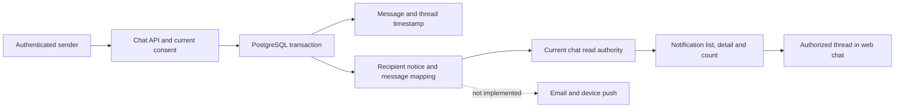

# Chat recipient notifications

## Incident and baseline

A production message was persisted on 2026-10-13 at 22:16:20 UTC without a
recipient inbox notification. Read-only inspection found no message notification
trigger, no notification insertion in `social_v2_chat_send`, and a UNIQUE
`index_chat_message_thread(thread_id)` constraint. The last constraint prevents a
second message, including the recipient's reply. The Persistent declaration
`IndexChatMessageThread threadId` was a unique key despite its name.

Inspected production API: `7ab344400d0878838b9b12742ca4cc5cd7f38f94`.
Implementation base: `aa7b70d10aee0057e8db9472a6b41e97ed765006`.
No production message bodies, addresses, credentials or account IDs are retained
in this report. No production data or configuration was changed.

## Requirements and implementation

`MSG-NOTIFY-001`: every newly committed direct message has exactly one minimized
in-app notice addressed to the other participant. Conversations permit multiple
messages. The message, notice and relationship commit or roll back together. The
existing current-session and consent guards remain authoritative. A rejected
send leaves no notice. List, detail and count hide notices when the thread is no
longer readable; deleting a message makes its retained notice invisible. A notice
contains no message excerpt, sender name or email. Its typed thread identity opens
only a conversation returned by the recipient's authorized thread list. The mobile
notification resolver is generated from the same registry and opens the canonical
web conversation through its existing authenticated-notification screen.

The additive migration drops only the verified, erroneously unique thread key,
retains the non-unique `(thread_id,id DESC)` history index, installs an AFTER INSERT
producer and extends the existing inbox visibility function. A one-to-one mapping
identifies each persisted message's notice. Existing notification type checks are
extended without discarding their expression. Historical messages are not replayed.
The corresponding Persistent unique declaration is removed to prevent recreation.



Message retries after an ambiguous HTTP response may still create two distinct
messages, each with its own notice. This does not establish request idempotency or
exactly-once provider delivery. Stored thread membership is assumed immutable via
application APIs. The PostgreSQL trigger covers both current SQL sends and legacy
Persistent inserts on a migrated database; SQLite has no production notification
qualification.

## External delivery remains incomplete

The operator confirmed the desired behavior: in-app bell, email when offline and
phone/browser notification with permission (proposed `MSG-DELIVERY-001`). This is not
implemented by the in-app correction. This proposed requirement is recorded here
and in [issue #577](https://github.com/diegueins680/tdf-app/issues/577); it has no implementation/test mapping yet, so it is
not represented as implemented in the executable requirement register. The current chat only polls and stores read
state locally; it lacks authoritative per-recipient message read/last-active state,
channel preferences, and a chat delivery worker. Operations push subscriptions are
organization-scoped and are not a general chat transport. The incident recipient
has zero records in that subscription table. Existing SMTP functions are not a
chat delivery pipeline. No recipient permission or successful device delivery has
been inferred from those facts.

Before enabling external delivery, implement recipient-authenticated read/activity
receipts, persisted opt-outs, a transactionally created delivery outbox, bounded
retry/backoff with dead letters and lease fencing, consent rechecks at dispatch,
coalesced offline reminders, registered Web Push/native subscriptions and click
navigation. SMTP acceptance must be distinguished from mailbox delivery. Provider
credentials/signing and device permissions must be configured through the approved
release process; never silently create them or send retrospective messages.

## Verification and rollout

Run against the fully migrated synthetic fixture:

```sh
TDF_CHAT_NOTIFICATION_DATABASE_URL=postgresql://127.0.0.1:PORT/NAME_test \
  sh scripts/test-chat-notifications.sh
```

The runner rejects production/remote URL overrides. It rolls all synthetic data
back. Assertions cover both conversation directions, atomic rollback, notification
storage failure, foreign identity, block/consent/inactive-account privacy and
message deletion. UI tests cover exact thread links, invalid/foreign targets,
login redirect preservation and existing account-switch privacy. Models for the
existing chat mutation boundary remain applicable; this work does not claim a
new proof of email/push delivery.

The runner also executes the existing interaction notification properties against
the complete migrated schema. Audited notices about moderation of an author's own
content retain their distinct visibility rule even after a social block; chat
notices do not acquire that exception. A negative control using the obsolete
interaction-only predicate must fail the moderation visibility assertion.

Production rollout is pending review, required checks and the established Hetzner
recovery procedure. Deploy the web target resolver before enabling the migration.
Keep the additive schema and minimized notices when reverting the application;
never restore the single-message UNIQUE constraint after conversations have replies.
If the producer must be paused, disable only `chat_message_recipient_notification`
under the approved release lock and record the unnotified interval. Keep the
visibility function/mapping so block and deletion policy continue to apply.
A historical catch-up requires a separately reviewed recipient-safe plan, not an
unbounded backfill. Do not claim that the original recipient was notified until
recipient-side runtime evidence establishes it.
