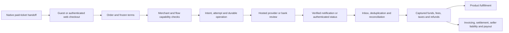

# Ecuador and international checkout review, 24 November 2026

**Decision.** Keep the existing four candidate integrations. PayPal wallet and manually reviewed bank transfer appeared in production routing for direct sales. The PayPhone Button has historical merchant test evidence. No additional provider passed all five merchant-specific gates in this review. There is no verified production portfolio covering recurring charges, local installments, connected sellers and all other requested methods. No activation follows from this review.

## Access and product evidence

| Check | Result on 24 November |
|---|---|
| Repository | Read default branch, history, provider branches, PRs, issues and CI. Dedicated worktree from main `736e84f597a9c50e71de062830a98a58f7d1d028`. Mobile gitlink `46efcbb0c35d7063e624b931be999c212980e2e3`. The integration-admission check passed. Safe Install and Build Image had failures on the starting branch. [Admission](https://github.com/diegueins680/tdf-app/actions/runs/45307270021) · [Safe Install](https://github.com/diegueins680/tdf-app/actions/runs/45299041474) · [Image](https://github.com/diegueins680/tdf-app/actions/runs/45299041561) |
| Existing work | Reviewed remote payment references, root and native open PR lists, and payment history. Reused the existing canonical checkout, ledger, payment recovery, marketplace agreements, failure alternatives and Stripe connected-account work. The closed PayPhone #781 was superseded by #783. Root and mobile already contain the hosted ticket handoff. [Button and mobile pin](https://github.com/diegueins680/tdf-app/pull/783) · [Fallback UX](https://github.com/diegueins680/tdf-app/pull/778) · [Stripe accounts](https://github.com/diegueins680/tdf-app/pull/782) |
| Production observation | Public version endpoint reported build `1184f9ffeffa2fd5f280fad2f026c12ab7224f4d` (23 November, 21:33:45 UTC). Public GET only. 51 method/flow/country observations at USD 10.00, described below. The samples demonstrate router output only. [Version](https://api.tdfrecords.net/version) · [Example capability query](https://api.tdfrecords.net/commerce/payment-capabilities?buyerCountry=EC&currency=USD&amountMinor=1000&paymentMethod=paypal_wallet&productFlow=event_ticket) |
| Staging | Historical Fly staging names yielded no reachable test API. Fly CLI had no authenticated access. The available Hetzner project exposed the known TDF production host. GitHub environment names, Preview secret names, repo secret names, local environment variable names and local payment staging worktrees identified no authorized payment staging profile. No staging writes or deployment. |
| Merchant test environments | PayPhone Developer and PayPal sandbox dashboard both redirected the existing browser profile to sign-in. Datafast certification credentials and PlaceToPay EC test-site credentials were not available through the checked configurations. No credential values were collected. The earlier Tdf Records Prueba receipt proves prior access to that store. It does not establish a current buyer session, the worker SLA or settlement. [Historical evidence](https://github.com/diegueins680/tdf-app/pull/783) |
| Developer environment | Disposable local PostgreSQL 16, GHC 9.10.3, Stack and Node 24. Native tests used the pinned mobile repository. The first web run reused an installed dependency tree. A later comparison found concurrent PR #757's i18next update in that tree. The final validation uses an independent npm ci from the payment branch's own lockfile. All local provider responses in automated tests were fixtures or mocks. |

For buyer countries EC and US, the capability endpoint returned PayPal wallet and manual bank transfer for merchandise, booking, professional service, course, event ticket and digital product; card returned no route for all six. For marketplace and subscription, all three methods returned no route in both countries. Additional EC ticket queries for bank redirect, DeUna QR and PayPhone wallet returned no route. PayPal ticket capabilities reported one-time, capture, full and partial refund and signed webhook. A route has additional checkout-specific completion, merchant, account and browser gates. It establishes neither approval by a bank nor fulfillment of an order.

## Availability, fees and evidence

Evidence date for the following rows is 2026-11-24. **High** means a published product detail or observed result. **Conditional** means a TDF merchant, acquirer, legal or commercial decision is outstanding. Across the table, merchant approval for the particular Ecuadorian S.A.S., USD bank settlement, network and country acceptance, reserves, settlement calendar, reconciliation files, refund/dispute fees, FX spread, support SLA and any unpublished price are **quote required** unless specified. A USD charge, a USD wallet balance and a payout to TDF’s USD bank account are three different events. The detailed comparison includes SDKs, mandate and lifecycle operations, settlement and the historical longlist. [Detailed provider and method inventory](ecuador-payment-platform-audit-2026-09-11.md)

| Method and candidate | Public evidence, buyer coverage and costs | TDF assessment |
|---|---|---|
| Domestic/foreign card, issuer installments and tokenization — Datafast | Ecuador acquiring requires RUC, merchant bank account, legal representative documentation and affiliation. Dataweb has a hosted widget, certification and issuer-specific deferred plans. Recurring is a separate product. Datalink takes domestic cards only. Its published fees are USD 12/month plus IVA and USD 0.20 plus IVA per submitted processing attempt. The Dataweb/acquirer price and installment schedule for TDF are quote required. [Dataweb](https://developers.datafast.com.ec/index.aspx) · [Affiliation](https://www.datafast.com.ec/Productos/SolucionesIntegrales) · [Recurring](https://developers.datafast.com.ec/pagos_recurrentes.aspx) · [Datalink pricing and restrictions](https://www.datafast.com.ec/Soporte/PreguntasFrecuentes) | Existing widget and authenticated status paths, locally tested. High for product; conditional for actual merchant certification, 3DS, approved BIN/issuer plans, foreign debit, authorization/capture, partials, tokens and payout timing. No public card route in the sample. |
| International PayPal wallet | Ecuador merchant schedule lists 5.40% + USD 0.30 for standard domestic/international commercial USD receipts. Original receiving fees are retained on commercial refunds. Discount tiers, FX, disputes, withdrawals, holds and limits depend on the transaction/account. PayPal supports sandbox Orders/webhooks and separate seller onboarding products. [EC merchant schedule](https://www.paypal.com/ec/business/paypal-business-fees) · [Partner onboarding by country/product](https://developer.paypal.com/platforms/seller-onboarding) · [Orders API](https://developer.paypal.com/docs/api/orders/v2/) | Existing direct wallet route, server confirmation and refund accounting. High for observed route and published schedule. Conditional for successful payment, withdrawal, capture/void, subscriptions, vaulting and partner entitlements. Partner approval must cover each seller's country and product. |
| PayPhone wallet, Button, QR, Link, split | Local business service publishes 5% + IVA on the commission. The web Button supports Visa, Mastercard, Diners, Discover and wallet payment. Hosted navigation must originate on an allowed merchant domain; Confirm has a five-minute deadline. Prueba uses an application/test-user configuration. Split requires commercial authorization and an eligible network recipient. Immediate and next-day transfers have different cancellation and reversal consequences. [Business pricing](https://payphone.app/para-negocios) · [Button](https://docs.payphone.app/boton-de-pago) · [Test configuration](https://docs.payphone.app/configuracion-de-ambiente-y-credenciales) · [Split](https://docs.payphone.app/split-de-pagos) · [Reverse](https://docs.payphone.app/api-reverse) | High for Button Prepare, pre-payment 404, single-element status array, idempotent Confirm, timeout cancellation and reversal response in the November test record. Wallet Sale and Button Prepare have different response contracts. Conditional for end-to-end worker confirmation, a credited seller, payout statement, recovery after refund, split authorization, and hosted QR/link fulfillment. |
| Single-use, shareable PayPhone Link | Link uses a client transaction reference of at most 15 characters, an amount, optional expiry and a single-use option. The documented flow does not call back to TDF. Its sample uses a Firebase Dynamic Links domain whose service shut down in 2025. [Link API](https://docs.payphone.app/api-link) · [Firebase service retirement](https://firebase.google.com/support/dynamic-links-faq) | Separate product. Require a real newly issued test link, host approval, a persisted unique short reference and an authoritative status/refund binding before offering it. The Button's return and reference contract cannot establish a Link payment. Never share lookup capabilities or a reusable provider session. |
| Ecuador bank buttons, DeUna/QR and secondary cards — PlaceToPay | EC test site, WebCheckout redirects and authenticated query. DeUna is an external redirect. Authorize/capture/reversal vary by method. Checkout refund uses the payment's internal reference and the documented partial-refund process requires settlement. Merchant site/acquirer terms, currencies, banks, fee and dispersion agreement are quote required. [EC test site](https://docs.placetopay.dev/en/checkout/test-your-integration/) · [DeUna](https://docs.placetopay.dev/en/payments/external-redirects/deuna/) · [Lifecycle](https://docs.placetopay.dev/en/gateway/transaction-types/) · [Refund](https://docs.placetopay.dev/en/checkout/refund/) | Existing disabled adapter, signed notification plus query, status polling and hosted methods. High for API; conditional for enabled site payment codes, USD deposit, 3DS, partial refund and split entitlements. |
| Bank transfer with human review | Existing server-side instructions, private evidence and finance review. A screenshot, user declaration or return URL cannot grant entitlement. | Existing and verified as an offered direct-sale method in the sample. Bank-cleared matching, international wire costs and timing, operator dual control and reconciliation require finance evidence. Unsuitable as an improvised marketplace custody mechanism. |
| Alternatives and substitutes | Nuvei EC publishes web, iOS, Android, Flutter and React Native SDKs, tokenized checkout and sandbox; no enrollment, integration or monthly fee is advertised. Kushki EC split documentation is access-controlled. Plux markets a payment button, DeUna and PeiGo market commercial wallets, Medianet publishes e-commerce instructions. [Nuvei integration](https://www.nuvei.com.ec/desarrolladores/) · [Nuvei fees](https://www.nuvei.com.ec/preguntas-frecuentes/) · [Kushki split](https://docs.kushki.com/ec/card-payments/split-payments/) · [Plux](https://www.plux.ec/boton-de-pagos/) · [DeUna](https://www.deuna.ec/negocios/empresas) · [PeiGo](https://www.peigo.com.ec/comercios-cobrar-con-billetera-virtual-peigo) · [Medianet](https://www.medianet.com.ec/ayuda_instructivo_ecommerce.php) | Nuvei/Kushki are alternate acquiring candidates if selected rails fail underwriting or certification. No measured advantage justifies another card integration. Direct wallets/POS with no TDF-usable integration, sandbox and settlement evidence remain conditional. |
| Cross-border, cash and other registered operators | dLocal lists EC card and cash-based methods; Payválida lists Ecuador collections and specifically excludes local card acceptance. The November 10 BCE register covers PSAPs and SEDPEs, including Ecuapayphone and Plux. Registration for switching, collection, remittance or processing does not establish merchant acquiring or custody permission. [dLocal EC](https://docs.dlocal.com/docs/ecuador) · [Payválida EC](https://payvalida.com/ecuador/) · [BCE participant register](https://www.bce.fin.ec/storage/BCE/sistemas_auxiliares/Catastro-PSAP-SEDPE-autorizadas.pdf) | dLocal/PayRetailers require proof of EC merchant onboarding and USD settlement. Payválida is lower priority for collections. Other listed gateway/processor candidates including Alignet, Bpay, Cardtech, Paggo, Paymóvil and Truepay lack a verified incremental merchant rail meeting the five gates. Cash collection is research only. |
| Stripe, Mercado Pago, cryptoassets and native digital billing | Ecuador is absent from Stripe direct-merchant availability and Mercado Pago's published country list. A separate authorized Stripe entity has distinct account/Connect obligations. BCE describes cryptoassets as unauthorized means of payment. Native digital purchases and real-world services are subject to different app-store rules and storefront exceptions. [Stripe](https://stripe.com/global) · [Mercado Pago](https://www.mercadopago.com.br/developers/en/docs/getting-started) · [BCE](https://www.bce.fin.ec/los-criptoactivos-no-son-una-moneda-de-curso-legal-ni-un-medio-de-pago-autorizado-en-ecuador/) · [Apple](https://developer.apple.com/app-store/review/guidelines/) · [Google](https://support.google.com/googleplay/android-developer/answer/9858738) | Exclude direct EC Stripe/Mercado Pago; keep the existing separately gated Connect work. No crypto or cash implementation. Native external ticket checkout is for real-world attendance. App-consumed subscriptions/licenses require storefront-specific billing review and any applicable program enrollment. |

## Selection and business flows

A candidate must pass five gates for its specific merchant and flow: EC company onboarding, USD settlement, supported integration, verifiable test environment, and appropriate security controls. Datafast, PayPhone and PlaceToPay publish Ecuador-facing products, and PayPal publishes Ecuador business terms. Their documented test procedures support development. Only PayPhone has a TDF controlled provider test in the reviewed evidence; none has newly verified USD bank settlement or a complete checkout-to-settlement run here. Exact legal entity and merchant-contract binding require operations evidence for each.

The scores below are engineering judgments for prioritizing contract verification. Counts use the existing weights. A 3 for conversion is neutral because no comparative authorization cohorts were available; it is not an estimate of conversion. Settlement scores account for documented observability and outstanding evidence. Total cost includes published fee and quote uncertainty. The reliability column measures the value of an independent rail; uptime and support response times are unmeasured.

| Candidate | Coverage 25 | Conversion 15 | Features 15 | Cost 10 | Settlement 10 | Support 10 | Reliability 10 | Effort 5 | Weighted / 5 |
|---|---:|---:|---:|---:|---:|---:|---:|---:|---:|
| Datafast | 4 | 3 | 3 | 3 | 3 | 4 | 3 | 4 | 3.40 |
| PayPal | 4 | 3 | 5 | 2 | 2 | 2 | 3 | 4 | 3.30 |
| PlaceToPay | 5 | 3 | 4 | 2 | 2 | 3 | 4 | 3 | 3.55 |
| PayPhone | 4 | 3 | 4 | 3 | 3 | 4 | 3 | 4 | 3.55 |
| Kushki | 4 | 3 | 3 | 2 | 2 | 3 | 3 | 2 | 3.00 |

Retain Datafast for issuer-approved installments, PayPal for the international wallet, PlaceToPay for bank/DeUna, and PayPhone for its wallet and the approved next-day split design. Each has a distinct target capability. The minimum production set is indeterminate until the merchant gates, pricing, authorization cohorts and settlement tests close. Reopen the selection if a contracted provider demonstrates it covers two of those roles. [Routing ADR](../adr/0115-provider-neutral-payment-routing.md) · [Marketplace decision](../adr/0136-marketplace-agreement-payments.md)

| Flow | Existing code and outstanding evidence |
|---|---|
| Merchandise, services, bookings, courses | Canonical orders, fee/tax components, public checkout recovery, receipts and finance review; deposited versus outstanding obligations must match the frozen order and its terms. Verify real checkout, refund, tax document, fulfillment, shipping or scheduling separately for TDF-owned products. [Checkout binding](../adr/0100-domain-linked-checkout.md) · [Versioned terms](../adr/0131-checkout-terms-version-identity.md) |
| Paid tickets | Mobile launches the canonical checkout without putting buyer PII in the handoff; ticket issuance/holds use verified payment evidence. Guest and authenticated paths, foreign issuer, interruption and refund-to-admission require credentialed end-to-end verification. [Ticket decision](../adr/0113-public-event-ticket-checkout-and-organizer-liability.md) |
| Digital licenses | Public web routing returns direct-sale methods; license grant, revocation, refund and invoice must be bound to the actual product order. Storefront policy is a separate gate on native. |
| Mandates, saved cards, recurring, preauth, delayed/partial capture | Local mandate/revocation and provider capability structures exist. Require consent, removable token, issuer/acquirer authorization, cancellation at provider, concrete product execution and reconciliation before listing a feature. Subscription routes were empty in the sample. [Recurring review](recurring-readiness-review-2026-09-16.md) |
| Hybrid marketplace | ADR 0136 uses an order-specific commission and provider share; third-party funds need approved receiving accounts. Verify payout recipient, liability, fee allocation, withholding, refund after transfer and disputed payout with finance. Record provider and bank settlement identifiers. Keep agreement collection gated while split verification is missing. Direct seller collection or an approved platform contract requires counsel/accounting review. [Manual gates](../marketplace/manual-gates.md) |

## Architecture, state, security and accounting



The diagrams and transition tables in ADRs 0100, 0101, 0104 and 0115 remain authoritative. Direct Datafast/PayPal product handlers share routing and checkout invariants but still include provider-specific execution. PayPhone and PlaceToPay use the hosted executor. The current router validates a positive amount and country-code syntax. Shared attempt creation supplies the unknown country code ZZ. A provider-specific country, issuer or amount band requires an evidenced merchant rule and a country bound to the order before restricting or promising a route. The EC and US samples alone cannot establish foreign-card acceptance. [Event verification](../adr/0101-verified-payment-events.md) · [Financial ledger](../adr/0104-immutable-financial-ledger.md) · [Router](../adr/0115-provider-neutral-payment-routing.md)

| Evidence/state | Customer and operational action |
|---|---|
| Prepared, including not contacted | Retain exact attempt and idempotency key. A worker can still claim it. |
| In flight, needs customer action, processing or unknown | Continue only the original authorized action or query the bound attempt. Preserve the lock on network loss. Use origin-only referrer for the PayPhone Button and suppress the referrer for PlaceToPay. |
| Failed or confirmed no charge | Release only when the server also reports authoritative retry permission. Mixed-version clients must enforce both conditions. |
| Provider approved, valid order | Apply bound amount, currency, provider resource and merchant evidence once before fulfilling. PayPhone Button additionally needs Confirm. |
| Late approval, contradictory evidence, refund or dispute | Hold fulfillment if required, retain the original ledger, reconcile and record a linked financial adjustment. Provider cash movement, credits, tax documents and seller liability each require independent evidence. |

**Threat review.** Compute totals and commissions in integer minor units and bind immutable order/attempt references to the expected merchant, currency and amount. Check resource ownership or the exact guest lookup capability before disclosing an attempt. Confirm that provider notifications are authenticated using the documented scheme; where the notification is only a hint, query the provider before posting any money. Keep environment-bound, durable deduplication and replay controls and row-locked transitions for duplicate, reordered or concurrent events. Hold ambiguous payments across processors and deny checkout access to authoritative status through redirect parameters alone. Retain role checks, reasoned admin audit entries and separation of refund, dispute and payout duties. Reconcile provider clearing and bank records daily, investigate drift and unreconciled obligations, and preserve financial evidence during rollback. Limit notifications, logs and browser referrers to what the payment requires. [Detailed threat register](ecuador-payment-platform-audit-2026-09-11.md) · [Notification minimization](../adr/0116-minimized-provider-notification-evidence.md) · [Atomic query application](../adr/0119-atomic-provider-query-application.md) · [Operations](operator-runbooks.md)

**Required qualified review.** Acquirer/QSA to determine applicable SAQ, script controls, scanning and current third-party attestations for each redirect/widget. TDF must keep PAN/CVV out of its API, logs and storage. Ecuador privacy counsel to document processing roles, minimization, consent or other lawful basis, retention, data-subject rights, incident process, and cross-border processors under the LOPDP and SPDP-SPD-2026-0004-R. Consumer counsel to review total USD price, issuer-approved installment terms, opt-in renewal, usable cancellation, deposits and refund language at checkout. Ecuador counsel and accounting to approve seller KYC, the contractual collector and invoice issuer, IVA/withholding and credit-note treatment, chargebacks, reserves, commission and seller liabilities. A gateway registration or recorded ledger balance alone does not authorize TDF to intermediate funds. [PCI SSC FAQ 1588](https://www.pcisecuritystandards.org/faqs/1588/) · [LOPDP](https://www.registroficial.gob.ec/quinto-suplemento-al-registro-oficial-no-459/) · [SPDP resolutions](https://www.spdp.gob.ec/resoluciones/) · [Consumer law](https://www.produccion.gob.ec/wp-content/uploads/2025/03/LEY-ORGANICA-DE-DEFENSA-DEL-CONSUMIDOR_2022_02_11.pdf) · [SRI electronic invoices](https://www.sri.gob.ec/facturacion-electronica) · [BCE register](https://www.bce.fin.ec/storage/BCE/sistemas_auxiliares/Catastro-PSAP-SEDPE-autorizadas.pdf)

## Datafast recovery after a database restore

Redelivery and fresh-process discovery have separate outcomes. After a pre-confirmation database restore, the canonical writer applied one of eight submitted copies of synthetic Datafast evidence. The harness supplied that evidence from memory. A separate 24 November rehearsal restored the same class of snapshot, started a fresh query worker with a ready test merchant and recovery enabled, and observed zero claimed jobs and zero transport calls. The saved checkout remained processing, with zero paid and zero receipts. The worker currently schedules PayPhone and PlaceToPay. A saved Datafast binding alone cannot recover an approval without a fresh authenticated status result or independent redelivery. For attempts absent from the snapshot, obtain independent provider transaction/settlement evidence. The separate Datafast recovery draft adds durable discovery and reports synthetic qualification of supported active holds. At commit 9c3a3b46d the PR reported eight passing PostgreSQL 16.10 restore-and-restart cases with synthetic transport, covering ticket, course, booking and Domo flows. Merchant certification and release qualification remain open. The four payment drafts reviewed here do not include that worker. [Datafast recovery draft #831](https://github.com/diegueins680/tdf-app/pull/831). [Fresh-process evidence](https://github.com/diegueins680/tdf-app/pull/826) · [Rehearsal design and earlier results](../evidence/datafast-payment-recovery-2026-11-18.md)

## Verification and remaining gates

1. Bind the designated non-production merchant and its registered test endpoint to the approved secret manager. Set the runtime checkout environment to sandbox. Keep the production account, callbacks and keys isolated. The operator runbook lists webhook registration, rotation, refund/void, settlement, dispute, seller payout and rollback procedures. [Operator runbooks](operator-runbooks.md)
2. For **Datafast**, obtain the test entity, bearer credential, certified base URL, widget/return domain and acquirer test pack. Test EC/foreign cards, 3DS, declines, issuer installments, token removal, capture/void/refund and deposit reports for each entitled product. For **PayPal**, provide a sandbox business merchant and separate buyer, OAuth client, matching merchant identity, registered webhook ID, event encryption key and refund scope. Qualify capture/replay, cancellation, pending, disputes, subscriptions and withdrawal/settlement separately. Partner onboarding requires its own approval.
3. For **PayPhone**, restore authorized Prueba access, a controlled buyer and registered origin/return URL. Bind `PAYPHONE_TOKEN`, `PAYPHONE_STORE_ID`, `PAYPHONE_RESPONSE_URL`; for Button verify the query worker, database queue, account and `checkout.provider_query_recovery` flag. Time payment to Confirm inside five minutes, then confirm ledger application once. For split, obtain the provider's commercial approval for the chosen modality, eligible recipient, 32-character split coding password, actual transfer and reversal/credit evidence. PayPhone requires an operating production product before applying for split. This external prerequisite must be addressed by the merchant under a separate release decision. [Split prerequisites](https://docs.payphone.app/split-de-pagos)
4. For **PlaceToPay**, obtain EC test-site login, secret, return/notification URLs and exact card/bank/DeUna method codes. Register a sandbox webhook. Exercise success, refusal, cancel, timeout, duplicate notification, independent status query, post-settlement refund and actual statement matching. Separate credentials and event evidence are required per environment.
5. Record sanitized provider/merchant receipt references, measured timings and settlement differences. Verify buyer recovery after tab/app switch, guest and authenticated checkout, receipts, entitlements, refunds, disputes and seller payouts on authorized staging. Close the legal, finance and PCI decisions, then use a separate activation review for each exact method and flow. No production migration, deployment, live transaction or seller transfer was part of this review.

This change adds no schema, seed or backfill. Existing external IDs are preserved. Rollback is a code revert; if the older backend is restored, retain the newer client protections and restrict hosted attempt creation pending reconciliation, since a claimable operation can again report retry permission. Drain or reconcile existing attempts before changing routes. Preserve evidence and pending recovery jobs when withdrawing a provider.

### Test record

Date 2026-11-24 UTC. Root baseline `736e84f597a9c50e71de062830a98a58f7d1d028`. Local tests changed only the dedicated worktree and disposable fixtures. The draft PRs identify the resulting revisions. Times below are execution windows. Returned gateway responses are mocked except where explicitly labeled historical or public read-only.

| Environment / command | Result |
|---|---|
| 05:38–05:41, before edits. Web Jest for `src/utils/providerPaymentResume.test.ts`, `src/pages/ProviderPaymentReturnPage.test.tsx`, `src/components/payments/HostedProviderCheckout.test.tsx` | 46 passed in three suites. |
| Before/after: from `tdf-hq`, `stack --no-terminal exec -- runghc -isrc -itest /private/tmp/tdf-payments-20261124-spec.hs`. The temporary Hspec main ran `TDF.Commerce.ProviderAdapterBindingSpec.spec >> TDF.Commerce.DatafastConfigSpec.spec`. | 31 baseline, 33 after repair, zero failed. Includes PayPhone creation-product boundaries and fallback. |
| `node --test scripts/__tests__/payment-readiness-helper.test.mjs scripts/__tests__/payment-query-report-contract.test.mjs` | 11 passed after supplying the local dependencies. Initial invocation lacked the YAML dependency. |
| `TDF_CANONICAL_PAYMENT_DATABASE_URL=postgresql://postgres@127.0.0.1:56284/tdf_canonical_payment_test ./scripts/test-canonical-payment-lifecycle-migration.sh` | Isolated PostgreSQL 16 migration, invalid operations, rollback/reapply and canonical history checks passed. Expected rejected fixture statements appear in the log. |
| Pinned mobile, `npm test -- --runTestsByPath __tests__/TicketCheckout.test.tsx __tests__/ticketCheckoutIdempotency.test.ts` | 22 passed, two suites. Mocked native handoff and idempotency. |
| 05:59–06:01, `npm --prefix tdf-hq-ui test -- --runInBand --runTestsByPath src/api/checkoutPaymentAlternatives.test.ts src/api/paymentCapabilities.test.ts src/__tests__/DatafastReturnPage.test.tsx src/components/payments/HostedProviderCheckout.test.tsx src/pages/ProviderPaymentReturnPage.test.tsx src/utils/providerPaymentResume.test.ts src/api/commerceOperations.test.ts src/pages/CommerceProviderEventsPage.test.tsx src/pages/PaymentsPage.recovery.test.tsx` | 100 passed, nine suites, including the dependent admin changes. Earlier focused runs passed (65 across six, 26 across two, 63 across five); some cases overlap. |
| `npm --prefix tdf-hq-ui run typecheck` and ESLint on changed web source/test files | Passed after supplying installed dependencies, including react-markdown. |
| `node scripts/check-generated-api.mjs`, `node scripts/check-api-availability.mjs`, `python3 scripts/test-checkout-money-verifier.py` | Both committed generated clients at the pinned revisions passed drift checks. API availability passed; eight money-verifier checks passed. |
| 06:00, production public GET `/commerce/payment-capabilities` | 51 successful read-only requests. Two countries × eight flows × three common methods, plus three additional EC ticket methods. |
| Credentialed provider tests and staging | No new run. Historical PayPhone Button Prueba evidence is linked above. Current checkout-to-refund, worker Confirm, statement settlement and seller payout require the accounts listed above. |

### Final qualification on the reviewed stack

At the code revisions below, a fresh isolated root and a fresh pinned mobile installation each ran `npm ci --ignore-scripts --no-audit`. The locked web i18next version was 23.16.8. The first offline root install lacked a cached dependency, so installation used the project registry. Reused installations from the earlier tests were superseded by these results. Times are UTC on 24 November.

| Time | Environment and command | Outcome |
|---|---|---|
| 06:27–06:32 | Web, exact payment suites listed below; `npm --prefix tdf-hq-ui run typecheck`; ESLint on all modified web source and tests | 263 tests in 26 suites passed. Typecheck and lint passed. A preliminary full-path filter also matched the worktree directory; it was stopped and rerun with exact paths. |
| 06:29–06:31 | Native pinned checkout, `npm test -- --runTestsByPath __tests__/TicketCheckout.test.tsx __tests__/ticketCheckoutIdempotency.test.ts` | 22 tests in two suites passed. |
| 06:29–06:31 | `REQUIRE_MOBILE_WORKSPACE=1 npm run generate:api && node scripts/check-generated-api.mjs` | Regenerated both clients; byte-for-byte identical to their committed revisions. An earlier run without installed native dependencies skipped native generation. |
| 05:44–06:35 | `TDF_PROVIDER_RETRY_DATABASE_URL=postgresql://postgres@127.0.0.1:56284/tdf_provider_retry_test sh scripts/test-provider-retry-runtime.sh` | 267 migrations applied and replayed. Full Haskell backend and test executable built. 533 examples, zero failures, one isolated restore case pending in this invocation. The script exited successfully after mandatory rollback checks. |
| 06:35–06:42 | Dedicated PG16 UTF-8 loopback cluster on port 56285, role synthetic, `sh scripts/load-payment-test-schema.sh` followed by `psql -f scripts/__tests__/fixtures/provider-domain-fixtures.sql`. Run the compiled test with `TDF_RECOVERY_RESTORE_LAB=synthetic-loopback-only TDF_PROVIDER_RETRY_DATABASE_URL=postgresql://synthetic@127.0.0.1:56285/tdf_provider_retry_test` and `--match='payment snapshot restore laboratory' --fail-on=empty +RTS -N2 -RTS`. | The separately gated case passed, one example and zero failures. The real dump/restore reverted a synthetic Datafast capture. Eight concurrent recovery attempts applied that payment once. The initial SQL_ASCII fixture and then a missing test-only schema required correction before the successful run. |
| 06:35 | Compiled `tdf-hq-test --match=validatePayPal --fail-on=empty +RTS -N2 -RTS` and `tdf-hq-test --match=validateDatafast --fail-on=empty +RTS -N2 -RTS` | 17 PayPal and 18 Datafast validation examples passed. |
| 06:02–06:32 | `node scripts/catalog-list-audit.mjs --decisions docs/catalog-persistence/catalog-list-decisions.json --fail-on-unreviewed --output /private/tmp/tdf-payments-20261124-catalog.json`; `python3 scripts/check-state-machines.py --static` | Strict catalog gate passed with pinned mobile initialized; 12 state-machine validators matched their models. |

The exact web invocation was

```sh
npm --prefix tdf-hq-ui test -- --runInBand --runTestsByPath src/__tests__/DatafastReturnPage.test.tsx \
  src/__tests__/DomoQuoteCheckoutPage.test.tsx \
  src/api/checkoutPaymentAlternatives.test.ts \
  src/api/commerceOperations.test.ts \
  src/api/paymentCapabilities.test.ts \
  src/api/providerPaymentSessions.test.ts \
  src/components/RefundManagementPanel.logic.test.ts \
  src/components/RefundManagementPanel.test.tsx \
  src/components/StripeCheckoutModal.logic.test.ts \
  src/components/__tests__/RefundManagementPanel.test.tsx \
  src/components/__tests__/StripeCheckoutModal.test.tsx \
  src/components/events/EventManualPaymentsPanel.test.tsx \
  src/components/payments/HeldRefundRecoveryPanel.test.tsx \
  src/components/payments/HostedProviderCheckout.test.tsx \
  src/components/payments/PaymentAlternativesNotice.test.tsx \
  src/components/payments/ProviderQueryRecoveryPanel.test.tsx \
  src/components/payments/ReconciliationEvidencePanel.test.tsx \
  src/components/payments/StripePaymentAlternativesNotice.test.tsx \
  src/components/payments/TicketBankTransferPanel.test.tsx \
  src/features/marketplace/agreementPayment.test.ts \
  src/i18n/paymentLocales.test.ts \
  src/pages/CommerceProviderEventsPage.test.tsx \
  src/pages/PaymentsPage.partySelector.test.ts \
  src/pages/PaymentsPage.recovery.test.tsx \
  src/pages/ProviderPaymentReturnPage.test.tsx \
  src/utils/providerPaymentResume.test.ts
```

Review in order. Each PR targets its predecessor. Retarget after the corresponding parent lands under the normal release process.

| Draft | Implementation commit | Scope |
|---|---|---|
| [#827](https://github.com/diegueins680/tdf-app/pull/827) | `afd5e941b` | Canonical retry authority, market assessment and operator documentation |
| [#828](https://github.com/diegueins680/tdf-app/pull/828) | `b9a8a6f84` | PayPhone create-response binding and adapter contract tests |
| [#829](https://github.com/diegueins680/tdf-app/pull/829) | `dca806700` | Buyer recovery, stale refresh, redirect referrers and compatible fallback |
| [#830](https://github.com/diegueins680/tdf-app/pull/830) | `5c5337c56` | Exact signed minor-unit display for finance overview, including fees, refunds, commissions, settlements and seller balances |

## Continuation on main 39935739

The payment drafts incorporated main `39935739e2def3817eaa2b84229cc2cc4b4941f1` after #757 merged. The common lockfile now installs i18next 26.3.4. The repository's exact Safe Install audit command, `./node_modules/.bin/audit-ci --config ./audit-ci.jsonc`, passed locally. Initial runs on the previous base had failed on GHSA-6jcc-5g8w-32mx. [Initial audit failure](https://github.com/diegueins680/tdf-app/actions/runs/45340082939) · [Merged dependency repair](https://github.com/diegueins680/tdf-app/pull/757)

On 24 November at 06:51–06:55 UTC, a mocked regression showed that a failed payment-status GET stopped polling and left a stale provider continuation available. The fix in #829 serializes manual and timer-driven reads, retries the original checkout and attempt after a temporary error, and withholds continuation until the next successful check. Once verified, a terminal result stops polling. The focused web run passed 42 examples in the hosted checkout and return-page suites, including the interrupted and concurrent-refresh cases. The pre-fix regression failed. The updated status behavior uses the existing API and storage format. [Checkout repair](https://github.com/diegueins680/tdf-app/commit/c3dda60ca)

At 06:56–06:59 UTC the combined stack (finance implementation `52a4a3a8a` and updated checkout parent `c3dda60ca`) passed 265 web tests in the same 26 suites listed above, 22 native ticket tests, 11 readiness/report contract checks, and web typechecking. Both API clients regenerated byte-for-byte from OpenAPI. ESLint passed for both edited checkout files. The source, SQL and backend test trees matched the previously qualified payment stack. No new merchant or staging transaction ran.

The production-mode web build also passed six synthetic Chromium checks for guest ticket QR downloads and the PayPhone origin-only referrer following a private ticket reload. Desktop, phone and tablet each exercised both cases. The command was `playwright test --config=/private/tmp/tdf-payments-continue-playwright.mjs --workers=1 --project=chromium-desktop --project=chromium-phone --project=chromium-tablet ticket-credential.spec.mjs`. The temporary configuration inherited the repository's Playwright settings and launched this worktree's own build on loopback port 42682. Provider requests were intercepted by the repository fixture. [Browser cases](../../e2e/web/ticket-credential.spec.mjs)

### Buyer return after an interrupted status request

On 24 November 2026, a desktop Chromium regression on the previous build reached the PayPhone return page and remained at the status-retry button after a synthetic HTTP 503. A separate unit regression found that a recently cached no-charge result could be displayed without reading the current attempt. At commit `4672faadf` the return page revalidates on entry, uses the session client's bounded retry policy for transient reads, and keeps the original recovery lock while offline. The explicit retry button remains available if the automatic attempts are exhausted. [Return-page change and regressions](https://github.com/diegueins680/tdf-app/commit/4672faadf817b71061f7faa65c60d99e384e3f2f)

The production-mode browser fixture now starts a private ticket checkout, opens the synthetic hosted PayPhone page, and navigates back in the same tab. The first status read receives a 503. The second read presents a synthetic verified payment. Desktop, phone and tablet each completed the flow with one creation and two reads of the original attempt, sending the private lookup capability in its request header. None of those requests reached a payment provider. The three guest QR-download checks also passed. [Browser regression](../../e2e/web/ticket-credential.spec.mjs)

At 07:12–07:16 UTC the two focused suites passed 44 tests. The combined stack reran the 26-suite Jest command above and passed 267 tests, as well as TypeScript and the generated-client drift check. The combined browser build used `npm --prefix tdf-hq-ui run build:e2e`; initial JavaScript was 394,611 gzip bytes. The six Chromium cases passed with `playwright test -c /private/tmp/tdf-payments-return-top-browser.mjs --workers=1 --project=chromium-desktop --project=chromium-phone --project=chromium-tablet ticket-credential.spec.mjs`. The temporary config used the repository defaults and served this build on loopback port 42683. One preliminary invocation loaded the runner and fixture from different worktrees and failed test collection; the recorded run used the same worktree for both.
